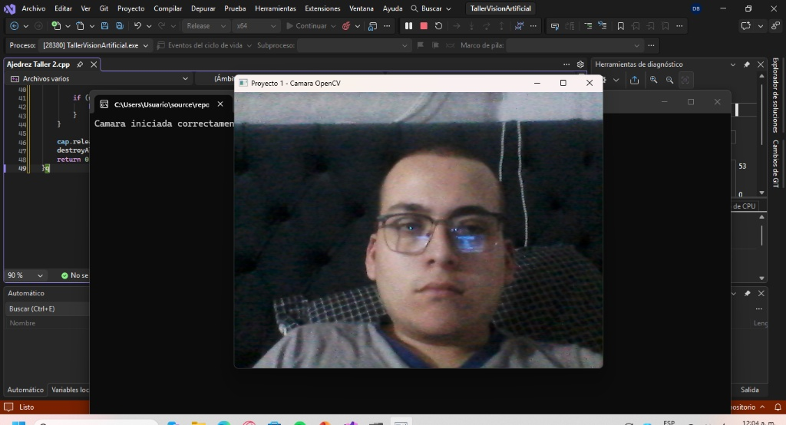
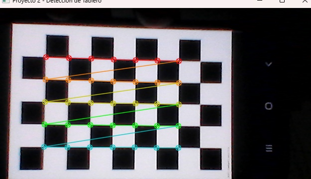
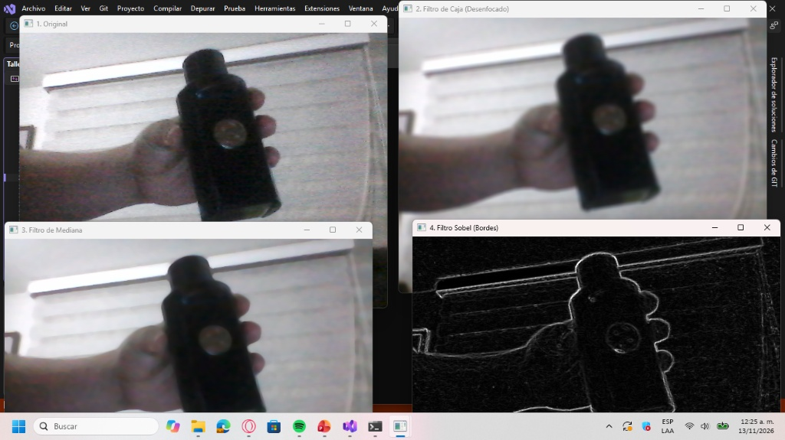
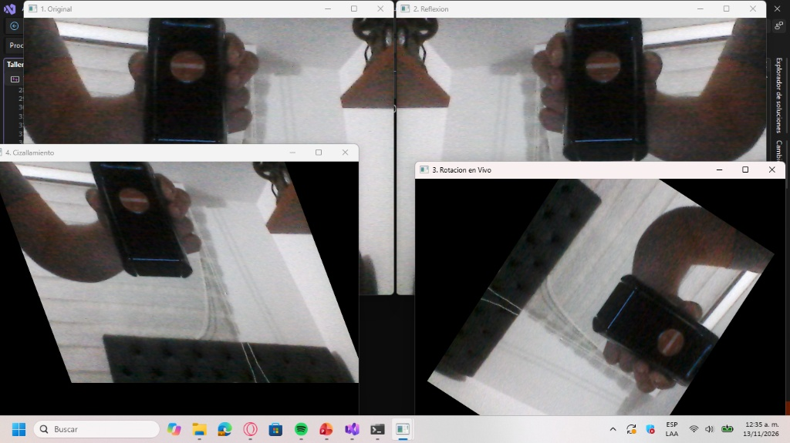

# Taller de Vision Artificial con OpenCV y C++

Este repositorio contiene la implementacion de los talleres practicos y proyectos avanzados de Vision Artificial, desarrollados para comprender el procesamiento de imagenes, transformaciones geometricas, calibracion de camaras y seguimiento en tiempo real.

---

## Entorno de Desarrollo
* **Lenguaje:** C++
* **Biblioteca:** OpenCV 5.0 (`opencv_world500.lib`)
* **IDE:** Visual Studio (Configuracion: Modo Release, Arquitectura x64)

---

## Proyectos Implementados y Estructura del Codigo

### 1. Talleres Principales (Con Evidencia Grafica)

* **`Funcionamiento Camara Taller 1.cpp` (Proyecto 1 - Captura de Video):**
  Lectura del flujo continuo de la camara web mediante `cv::VideoCapture` para validar la inicializacion del entorno y la visualizacion de fotogramas.
  

* **`Ajedrez Taller2.cpp` (Proyecto 2 - Calibracion y Deteccion de Tablero):**
  Implementacion de `findChessboardCorners` sobre un patron de tablero de ajedrez para la deteccion de esquinas y caracteristicas, como paso previo a la calibracion optica.
  

* **`Cuatro Filtros Taller 3.cpp` (Proyecto 3 - Filtros Espaciales):**
  Aplicacion de convolucion espacial en tiempo real desplegando cuatro ventanas simultaneas: imagen original, filtro de caja (Box Filter), filtro de mediana para reduccion de ruido y operador de Sobel para deteccion de bordes.
  

* **`Transformaciones afines Taller 4.cpp` (Proyecto 4 - Transformaciones Afines):**
  Manipulacion geometrica mediante matrices afines de 2x3 (`warpAffine`), implementando reflexion en espejo, rotacion animada basada en calculo trigonometrico manual y cizallamiento.
  

---

### 2. Mini-Proyectos Avanzados

* **`Virtual Painter.cpp`:**
  Lienzo interactivo basado en segmentacion de color HSV y analisis de contornos para realizar trazos en el aire en tiempo real utilizando un objeto de color especifico.

* **`Document Scanner.cpp`:**
  Sistema de deteccion de contornos rectangulares y transformacion de perspectiva (`warpPerspective`) para escanear, enderezar y recortar documentos automaticamente.

* **`Plate detector.cpp`:**
  Algoritmo de filtrado avanzado y analisis de proporciones geometricas para la localizacion y recorte de placas vehiculares en tiempo real.

